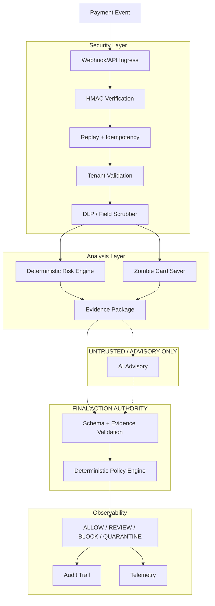

# Architecture

## Pipeline Overview

## Security Boundaries

### 1. Webhook Security
All incoming events undergo strict validation. HMAC ensures payload integrity, the idempotency layer rejects replays, and the tenant boundary verifies the `x-tenant-id` matches the payload's `merchant_id`.

### 2. AI Advisory Boundary
The AI output is treated strictly as **Untrusted / Advisory Only**. It is validated for evidence integrity (it cannot cite fake evidence IDs) and it cannot override the Deterministic Policy Engine. The LLM has zero direct remediation authority (e.g., it cannot execute a refund or revoke a token).

### 3. Deterministic Policy Authority
The **Deterministic Policy Engine** is the ultimate authority. It evaluates the deterministic risk assessment, the Zombie Card Saver signals, and the AI advisory (if available and valid). If the LLM is unavailable or compromised, the deterministic path ensures safe default handling.

### 4. Audit Trail
Every decision is securely logged with cryptographic hashing linking events to their audit records. Tenant isolation is enforced during audit retrieval.
